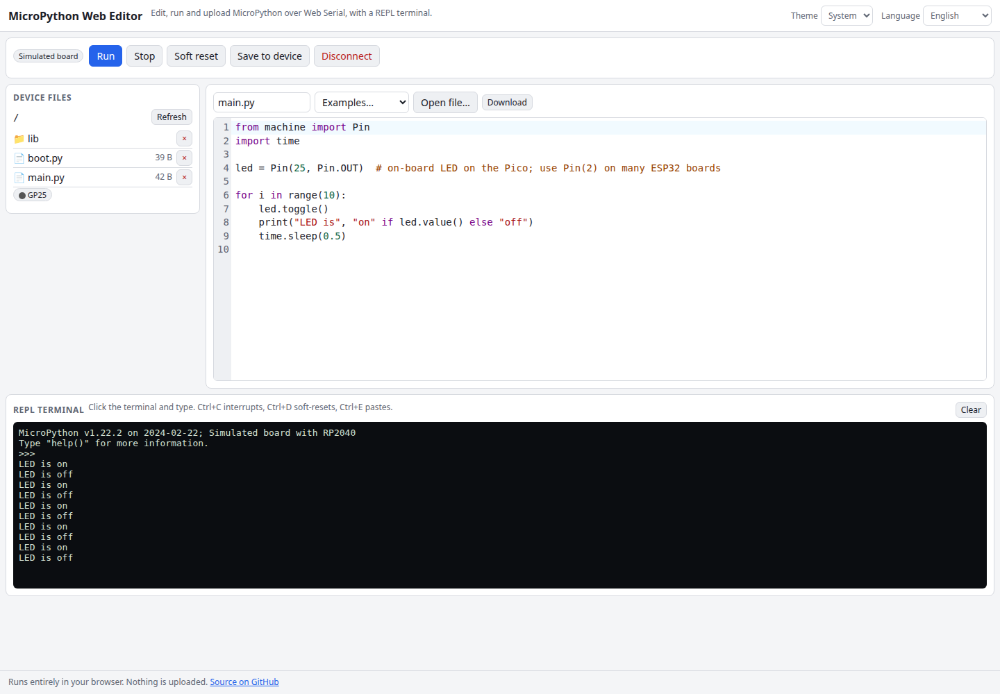

# MicroPython Web Editor

A MicroPython editor that runs in your browser. Write code in a CodeMirror editor, press Run to execute it on your board over Web Serial using the raw REPL (with raw-paste flow control), save it as `main.py`, browse and manage files on the device, and use a live REPL terminal. No board at hand? Start the built-in simulated board, which speaks the same REPL protocol.

**Try it: [hermes98761234.github.io/micropython-web-editor](https://hermes98761234.github.io/micropython-web-editor/)**

[](https://github.com/hermes98761234/micropython-web-editor/actions/workflows/deploy.yml)



## Features

- **CodeMirror 6 editor** with Python highlighting, line numbers, light and dark themes, Ctrl+Enter to run.
- **Run over raw REPL**: Ctrl-C, Ctrl-A, raw-paste mode (Ctrl-E `A` 0x01) with window flow control, falling back to the legacy raw REPL. Output streams to the terminal as it is produced; Stop sends Ctrl-C.
- **Upload and files**: save the editor to any path, list directories, open a device file in the editor, delete files and folders, all through small helper snippets run on the board.
- **REPL terminal**: type straight into the friendly REPL with line editing, Ctrl-C, Ctrl-D (soft reset) and Ctrl-E (paste mode).
- **Simulator**: a small Python-subset interpreter (functions, loops, f-strings, try/except, `machine.Pin`, `time`, `os`, files) behind a fake board that implements the REPL, raw REPL and raw paste byte protocol, with virtual pin LEDs.
- Open and download local `.py` files, examples, English and Ukrainian UI, light/dark theme. Nothing leaves your browser.

## How it works

`lib/device.ts` drives any `Transport`: a `SerialTransport` over the Web Serial API or the `SimBoard`. Every file operation is a short Python snippet executed in the raw REPL (`os.ilistdir`, `open(...).write(unhexlify(...))`, and so on), so it works on any MicroPython board without extra firmware. The protocol code is covered by tests that run the full stack against the simulator, including flow control with code larger than the paste window and Ctrl-C interrupting a running loop.

Web Serial needs Chrome or Edge on desktop and a secure context (HTTPS or localhost).

## Quick start

You need [Node.js](https://nodejs.org/) 22.

```bash
git clone https://github.com/hermes98761234/micropython-web-editor.git
cd micropython-web-editor
npm install
npm run dev       # http://localhost:5173
npm test          # protocol, terminal and interpreter tests
npm run build     # static site in dist/
```

## License

MIT
